# КТ-19 - Аутентификация и авторизация на основе куки

Студент - Денисенко Даниил Евгеньевич  
Группа - 4п4.23 NET  
Дисциплина - ADO.NET  

### Задания

Научиться реализовывать аутентификацию и авторизацию на основе куки в приложении ASP.NET Core с использованием SignalR для создания защищенного чата.

Задачи:

- Выполнить задание согласно ТЗ (рекомендуется встроить в свой проект);
- Составить файл отчета, содержащий скриншоты выполнения и ссылки на код.

ТЗ:

1. Настроить аутентификацию и авторизацию на основе куки в приложении ASP.NET Core.
2. Реализовать регистрацию и вход пользователей.
3. Создать защищенный чат с использованием SignalR.
4. Ограничить доступ к чату только авторизованным пользователям.

### Задание 1

Настроил вход через куки и добавил страницы регистрации и чата
После входа в шапке отображается имя пользователя

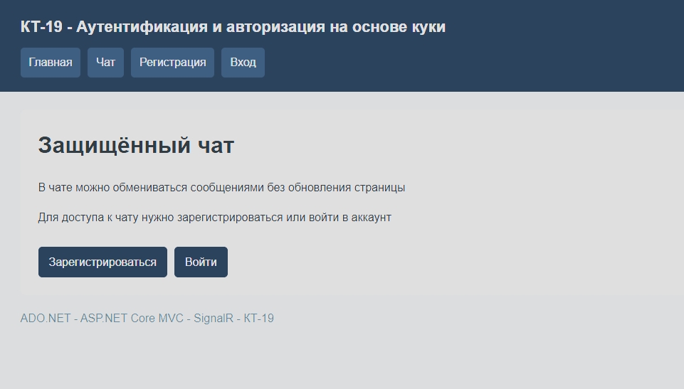

На главной странице есть ссылки на регистрацию, вход и чат

### Задание 2

Сделал регистрацию и вход с проверкой данных
Пользователи сохраняются в SQLite, вместо паролей хранятся их хеши
Повторное имя и неправильный пароль вызывают ошибку

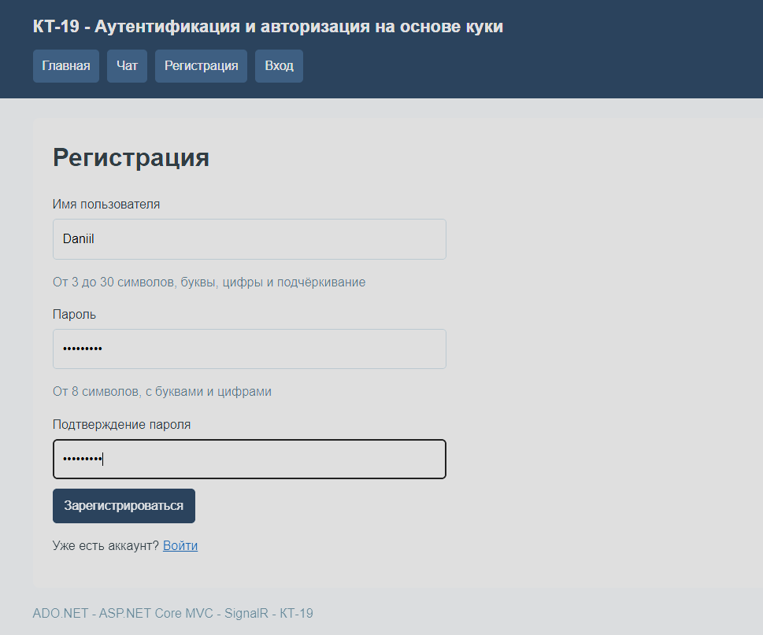

В форме указаны имя пользователя, пароль и его подтверждение

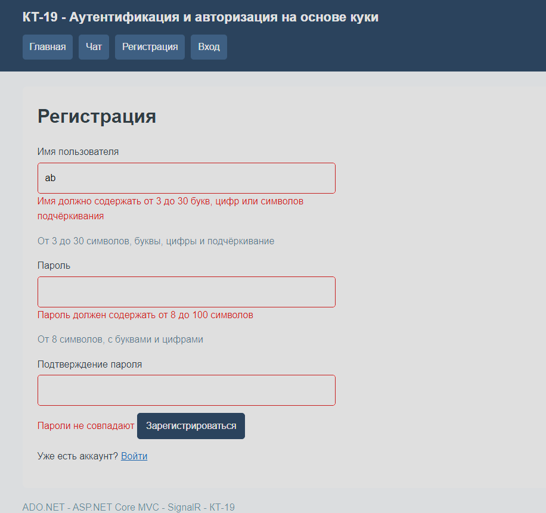

Сервер проверяет длину имени, требования к паролю и совпадение паролей

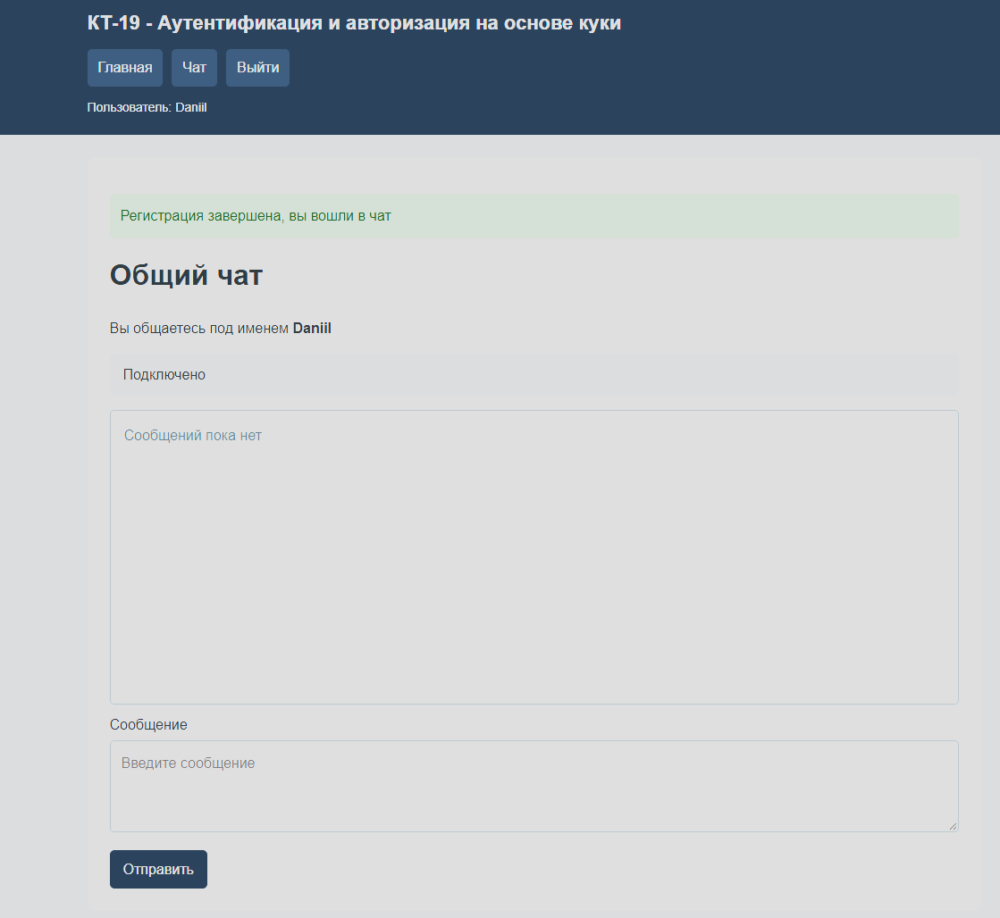

После регистрации открыт чат, в шапке показано имя Daniil

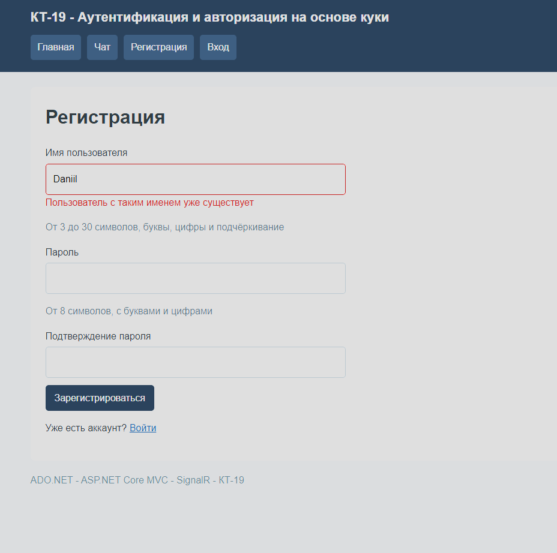

Повторная регистрация с тем же именем не проходит

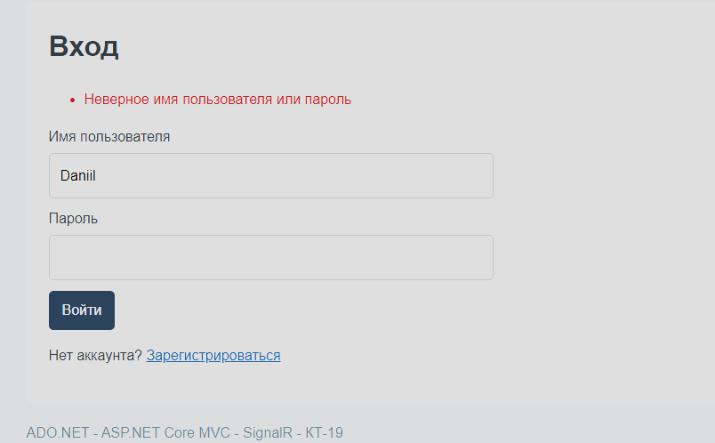

При неверном пароле отображается сообщение об ошибке

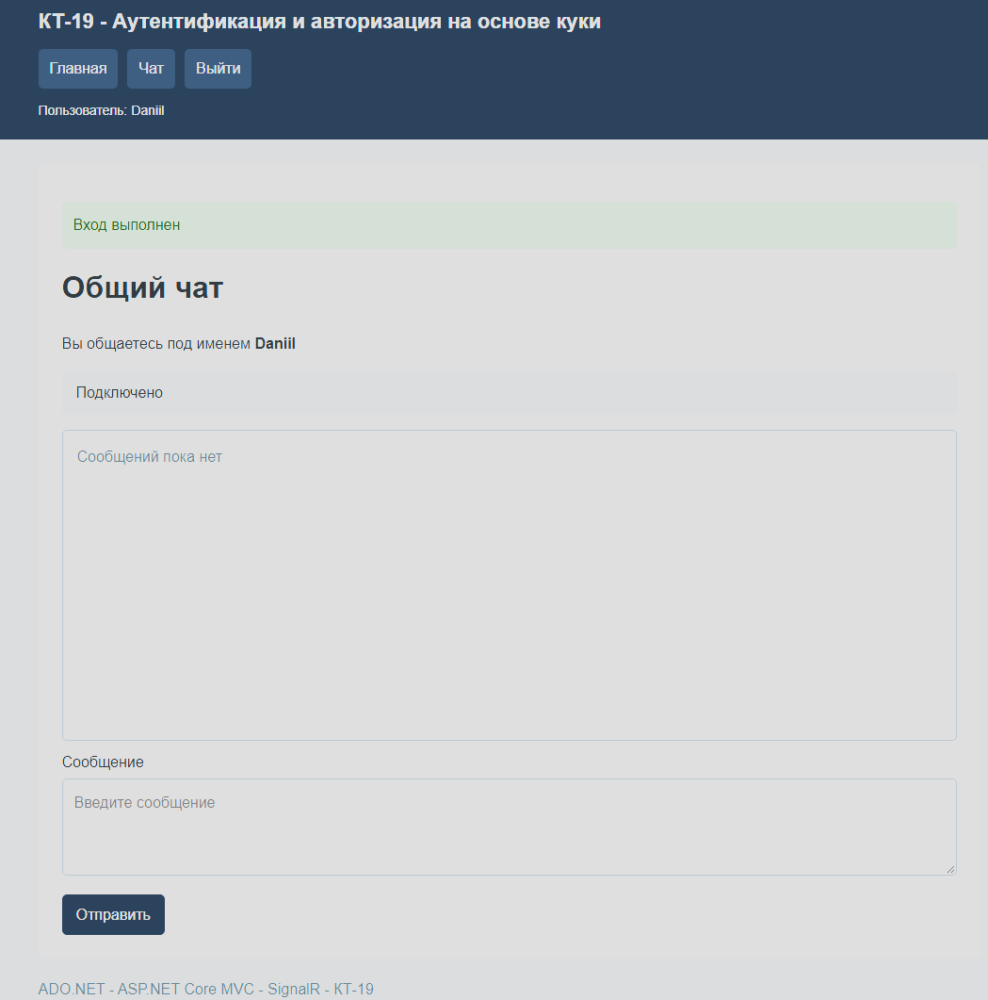

После правильного ввода данных открыт чат и показано сообщение об успешном входе

### Задание 3

Сделал общий чат на SignalR
Сообщения приходят без обновления страницы, рядом видны имя и время
Пустое сообщение отправить нельзя

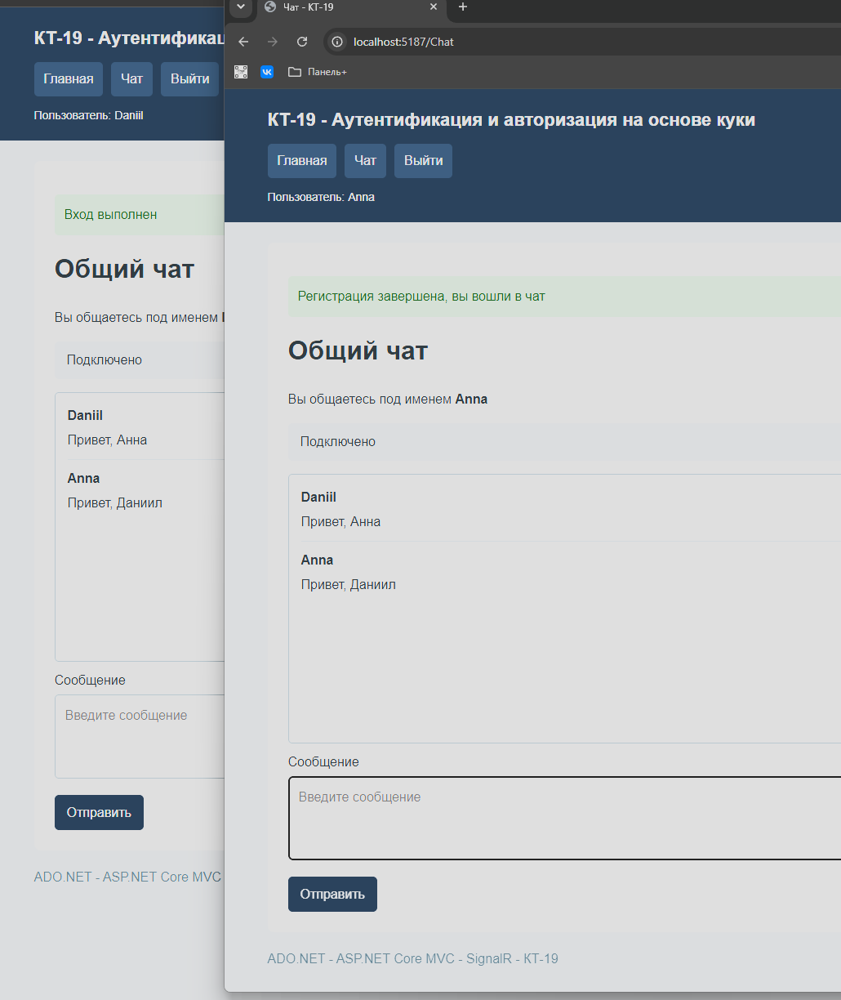

Daniil и Anna обмениваются сообщениями, переписка видна в обоих окнах

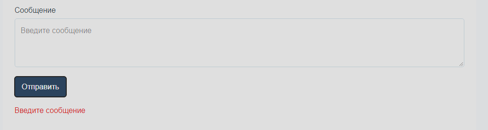

При отправке пустого сообщения показана ошибка

### Задание 4

Закрыл страницу чата и хаб для гостей
После выхода куки удаляется, соединения этого сеанса закрываются
При повторном открытии чата без входа появляется форма входа

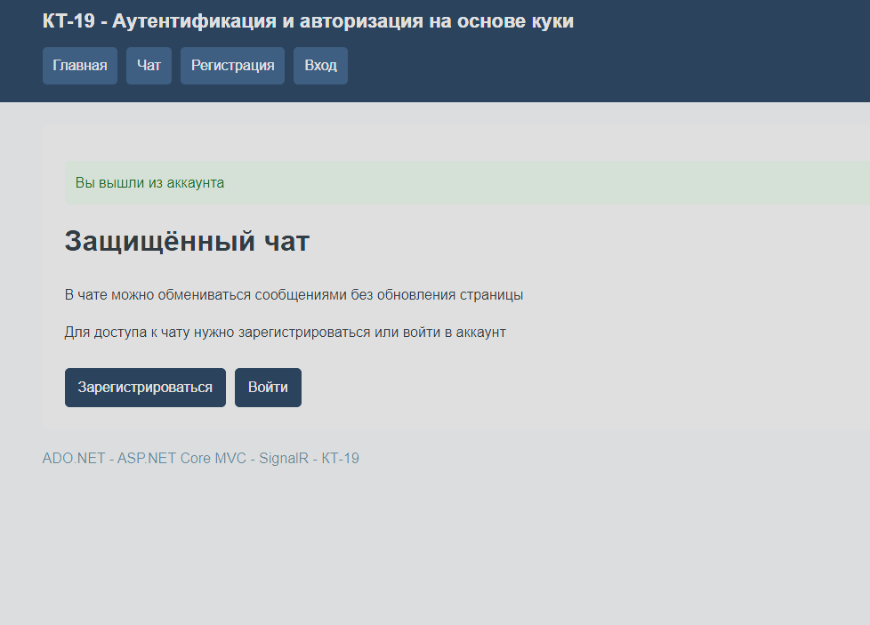

После выхода открыта главная страница, имя пользователя больше не отображается

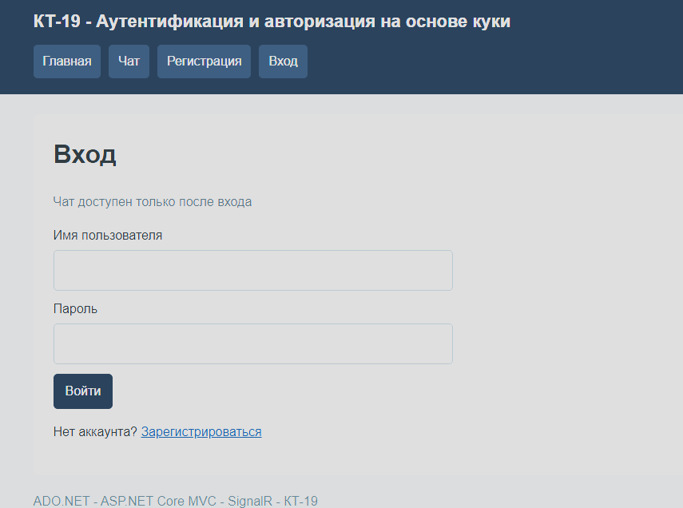

При открытии чата без авторизации отображается форма входа
